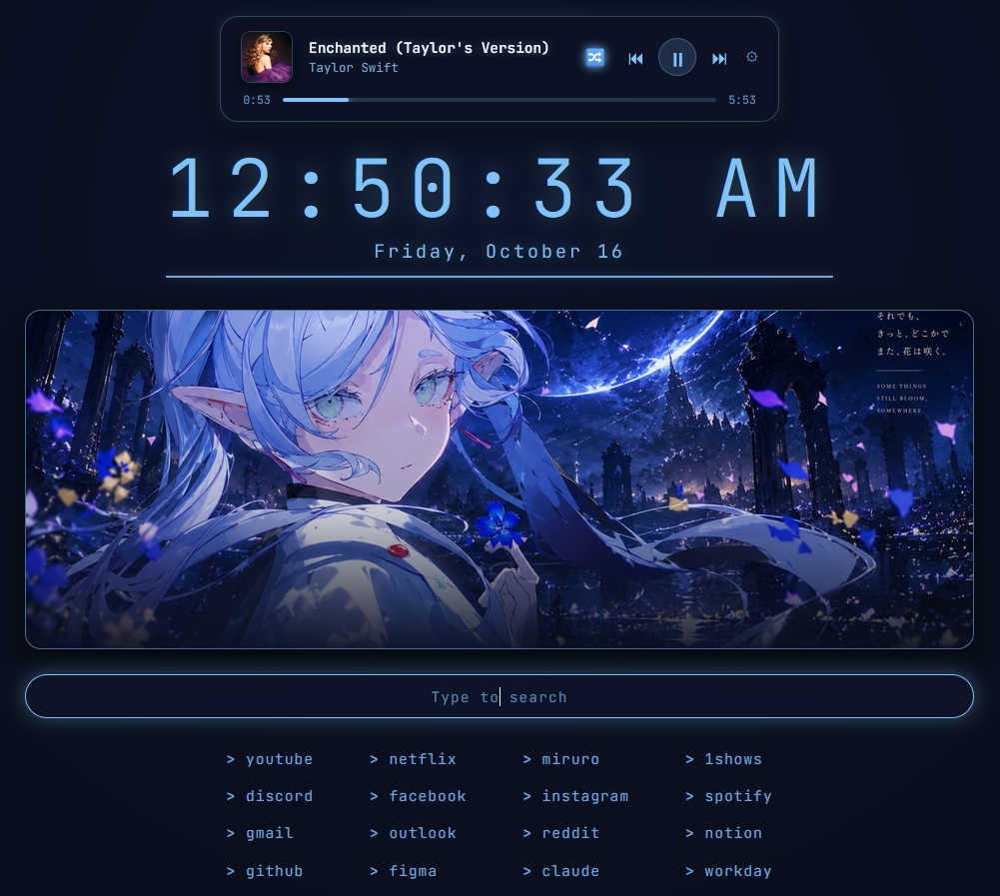

<div align="center">


# フリー・ウェブ (Furi-Web)
### *Beyond Journey's End Browser Build*

[](https://github.com)
[](https://floorp.app)
[](https://github.com/Floorp-Projects/Floorp)
[](https://frieren-anime.jp)
[](LICENSE)

*A deeply customized, magical browsing environment engineered on Floorp 12 (Gecko 157+ & Noraneko engine), dedicated to the serene aesthetic of **Sousou no Frieren (葬送のフリーレン)**.*

<br/>



</div>

---

## ✦ Overview

**Furi-Web (フリー・ウェブ)** transforms Floorp into an enchanting, distraction-free browser crafted for journeying across the open web. Built from the ground up with native Gecko internal hooks, modern CSS hardware-accelerated animations, and an integrated startpage engine, Furi-Web marries Japanese anime minimalism with high-performance productivity.

### ✨ Highlights at a Glance
- 🔮 **Native Titlebar & Icon Rebranding:** Replaces all Floorp/Firefox branding with `フリー・ウェブ` across Windows Taskbar, Start Menu, Window Titlebar, and Win32 icon handles via Gecko AutoConfig.
- 🪟 **Floating Rounded Viewport:** Cozy, card-like web content surface surrounded by customizable margins, subtle drop-shadows, and macOS-style traffic light window controls.
- 🌿 **Auto-Collapsing Sidebery v5 Rail:** Clean vertical tab tree on a micro-rail that expands smoothly on hover with native Floorp Panel Sidebar docking.
- 🎵 **Spotify Connect PKCE Integration:** Live playback controls, real-time scrubbing seek bar, album art display, and track status right on your new tab page.
- 🌸 **2-Layer Optical Dissolve Artwork:** Dynamic art cards featuring Blue Moon-weed flower fields that dissolve smoothly on interaction.
- 🌦️ **Open-Meteo Weather & 24h Clock:** Real-time weather diagnostics with auto-calculated "Feels like" indices and digital 24-hour timekeeping.

---

## 🏛️ Architecture & The Four Pillars

```
+-------------------------------------------------------------------------------+
|  フリー・ウェブ (Furi-Web) Custom Distribution Architecture                   |
+------------------------------------+------------------------------------------+
|  1. AutoConfig Rebranding Engine   |  2. Cozy Floating Chrome & Sidebery      |
|     - DOM Title & Brand Mutator    |     - Hardware-accelerated rounded canvas|
|     - Win32 WM_SETICON runtime hook|     - Compact auto-expanding Sidebery rail|
|     - Windows StartMenuInternet    |     - Floorp native Panel Sidebar        |
+------------------------------------+------------------------------------------+
|  3. Frieren Startpage Engine (XPI) |  4. 1-Click Portable Deployment          |
|     - Spotify Connect Web API PKCE |     - Automated Install_FuriWeb.bat      |
|     - Dual-layer optical dissolve  |     - Non-destructive userChrome backup  |
|     - Open-Meteo live weather data |     - Startup cache purge & uninstaller  |
+------------------------------------+------------------------------------------+
```

<br/>

### Pillar 1: フリー・ウェブ Native Engine Rebranding
Rather than relying solely on surface stylesheets, Furi-Web implements a low-level Gecko **AutoConfig Engine Hook** (`autoconfig/floorp.cfg`):
- **DOM & Titlebar Hook:** Patches `Tabbrowser.prototype.getWindowTitleForBrowser` and intercepts `browser-delayed-startup-finished` to strip away `Floorp` / `Firefox` references, dynamically branding every window and document title to `フリー・ウェブ`.
- **Win32 Runtime Icon Override:** Binds into `nsIWindowsUIUtils` to enforce `dark.ico` directly to the underlying OS window handle (`HWND`), preventing icon revert on tab switches.
- **System Start Menu Registration:** Re-registers `HKCU:\Software\Clients\StartMenuInternet` keys to register `フリー・ウェブ` as the primary browser display name and icon in Windows Search and Taskbar pinning.

<br/>

### Pillar 2: Cozy Floating Chrome & Sidebery v5 Rail
Furi-Web reimagines browser chrome layout with a fluid floating geometry:

<div align="center">
  
</div>

- **Floating Viewport:** The web content pane is detached from the edge with a floating gap (`--shina-frame-edge-gap: 15px`), rounded corners (`border-radius: 12px`), and subtle ambient glow (`--shina-surface-shadow`).
- **Unified Minimal Header:** The URL bar, tab bar, and navigation buttons are condensed into a sleek top rail with custom macOS traffic-light buttons (Close, Minimize, Maximize).
- **Auto-Expanding Sidebery Vertical Tabs:** Replaces cluttered top tabs with a 48px micro-rail that expands to a full tree hierarchy on mouse hover, keeping maximum screen real-estate for web content.
- **Floorp Panel Sidebar Dock:** Integrated styling in `chrome/variants/panel-sidebar.css` harmonizes browser web panels with the overall palette.

<br/>

### Pillar 3: Native Blue Moon-weed Startpage Engine (`frieren_startpage.xpi`)
Packaged as a lightweight Gecko WebExtension, the startpage delivers instant load times:

<div align="center">
  
</div>

- **Spotify Connect Player:** Built using standard **PKCE (Proof Key for Code Exchange)** authorization:
  - Supports Play, Pause, Previous, Next, and interactive seek scrubbing.
  - Automatically polls playback state and smoothly animates track progress locally every second.
- **Dual-Layer Optical Dissolve:** Uses two overlapping banner layers (`.banner-layer-a`, `.banner-layer-b`) with opacity cross-fades to display official Frieren Blue Moon-weed art assets.
- **Real-Time Weather Widget:** Fetches hyper-local forecasts from the Open-Meteo REST API without requiring any private API keys.
- **Keyboard-Centric Search & Quicklinks:** Centered search capsule with instant autofocus and a 4-column quick navigation grid.

<br/>

### Pillar 4: 1-Click Automated Deployment
- **`Install_FuriWeb.bat`**: Double-click launcher that triggers standard Windows UAC self-elevation and invokes `Install-FuriWeb.ps1`.
- **Zero-Hardcoding**: Works reliably on any Windows installation by scanning `profiles.ini`, registry paths, and system program folders.
- **Safe & Non-Destructive**: Backs up existing `userChrome.css` to `userChrome.css.bak`, safely merges required Gecko preferences, and provides a full restore script (`Uninstall-FuriWeb.ps1`).

---

## 🚀 Quick Start (Installation)

### Method A: 1-Click Installer (Recommended)
1. Close all running instances of Floorp.
2. Clone or download this repository:
   ```powershell
   git clone https://github.com/Exryz/Furi-Web.git
   cd Furi-Web
   ```
3. Right-click **`Install_FuriWeb.bat`** and click **Run as administrator** (or simply double-click; it will self-elevate).
4. Launch Floorp — your titlebar, icons, and floating chrome are now active!

---

### Method B: Manual Installation

<details>
<summary><b>Click to expand manual setup instructions</b></summary>

#### Step 1: Copy Engine Hooks
Copy the AutoConfig files into your Floorp program directory (e.g., `C:\Program Files\Ablaze Floorp\`):
- `autoconfig/defaults/pref/autoconfig.js` ➔ `<FloorpDir>\defaults\pref\autoconfig.js`
- `autoconfig/floorp.cfg` ➔ `<FloorpDir>\floorp.cfg`
- `autoconfig/icons/dark.ico` ➔ `<FloorpDir>\dark.ico`
- Copy `autoconfig/icons/dark.ico` into `<FloorpDir>\browser\chrome\icons\default\` as `main-window.ico`, `default.ico`, `default16.ico`, `default32.ico`, `default48.ico`, `default64.ico`, and `default128.ico`.

#### Step 2: Deploy Profile Styles
In your Floorp profile folder (`%APPDATA%\Floorp\Profiles\<profile>\`):
1. Create a `chrome` directory if it does not exist.
2. Copy `chrome/userChrome.css`, `chrome/dark.png`, `chrome/light.png`, `chrome/frieren/`, and `chrome/variants/` into `<profile>\chrome\`.
3. Append the contents of `chrome/user.js` to your profile's `user.js`.

#### Step 3: Clear Startup Cache
Delete the folder `%LOCALAPPDATA%\Floorp\Profiles\<profile>\startupCache` to force Floorp to rebuild its CSS cache on launch.

</details>

---

## 🧩 Setting Up Add-ons

### 1. Load the Startpage Extension (`releases/frieren_startpage.xpi`)
1. Open Floorp and navigate to `about:addons`.
2. Click the gear icon (**⚙**) in the top right corner and select **"Install Add-on From File..."**.
3. Select `releases/frieren_startpage.xpi` from this repository.
4. When prompted, grant permissions. Your new tab is now powered by Furi-Web!

### 2. Configure Sidebery v5 Vertical Tabs
1. Install [Sidebery](https://addons.mozilla.org/firefox/addon/sidebery/) from Firefox Add-ons if not already installed.
2. Open the Sidebery panel on your Floorp sidebar.
3. Open Sidebery Settings (gear icon at the bottom of the sidebar) ➔ navigate to **Styles editor**.
4. Copy the entire contents of [`sidebery/sidebery.css`](sidebery/sidebery.css) and paste it into the editor.
5. Click **Save styles**.

---

## 🎵 Spotify Connect Setup Guide

The startpage includes a built-in Spotify player powered by Spotify's official Web API using secure PKCE (no secret key required):

```
+--------------------------------------------------------------------------+
|  Spotify Developer Dashboard Setup                                       |
+--------------------------------------------------------------------------+
|  1. Go to https://developer.spotify.com/dashboard and log in.            |
|  2. Click "Create app".                                                  |
|     - App name: Furi-Web Startpage                                       |
|     - App description: Sousou no Frieren browser startpage player        |
|     - Redirect URI: Copy the moz-extension:// URI shown on your startpage|
|       (e.g., moz-extension://<UUID>/index.html)                          |
|     - Which API are you using? Web API                                   |
|  3. Save the app and copy your Client ID.                                |
|  4. On the Furi-Web new tab, click "Connect Spotify", paste your Client  |
|     ID, and authenticate!                                                |
+--------------------------------------------------------------------------+
```

> [!TIP]
> Once connected, the player communicates directly with active Spotify playback across your PC, phone, or Spotify Connect speakers. You can pause, play, skip tracks, and scrub through the track with the live progress bar.

---

## 🎨 Customization Guide

### Switching CSS Variants
Furi-Web includes multiple userChrome variants inside `chrome/variants/`:
- **`frieren-blue-moon-weed.css`**: The ethereal blue-and-gold aesthetic matching the anime's signature flower fields.
- **`panel-sidebar.css`**: Dedicated styles for Floorp's floating web panel.

To switch to Blue Moon-weed variant:
1. Open `<Profile>\chrome\userChrome.css`.
2. Replace or import the variant at the top:
   ```css
   @import "variants/frieren-blue-moon-weed.css";
   ```

### Customizing Startpage Quicklinks
Edit `extension/index.html` (or modify and repackage via `zip -r frieren_startpage.xpi *`):
```html
<div class="links-grid">
  <a href="https://github.com">github</a>
  <a href="https://youtube.com">youtube</a>
  <a href="https://reddit.com">reddit</a>
  <a href="https://discord.com">discord</a>
</div>
```

### Changing Live Weather Coordinates
In `extension/app.js`, edit line 27 with your local latitude and longitude:
```javascript
const res = await fetch(
  'https://api.open-meteo.com/v1/forecast?latitude=YOUR_LAT&longitude=YOUR_LON&current=temperature_2m,relative_humidity_2m,apparent_temperature,weather_code'
);
```

---

## 🗂️ Repository Directory Structure

```
Furi-Web/
├── .gitignore
├── LICENSE
├── README.md
├── Install_FuriWeb.bat              # Double-click self-elevating installer
├── Install-FuriWeb.ps1              # Full portable PowerShell installation engine
├── Uninstall-FuriWeb.ps1            # Uninstaller and default Floorp restoration script
├── assets/                          # Showcase screenshots and brand emblems
│   ├── icon.ico
│   ├── logo.png
│   ├── preview-browser-frame.png
│   ├── preview-startpage-full.png
│   └── preview-startpage-spotify.jpg
├── autoconfig/                      # Low-level Gecko engine branding hooks
│   ├── floorp.cfg                   # DOM titlebar replacer & Win32 icon enforcer
│   ├── defaults/pref/
│   │   └── autoconfig.js            # AutoConfig bootstrap config
│   └── icons/
│       └── dark.ico                 # High-resolution multi-size brand icon
├── chrome/                          # Floorp userChrome styling suite
│   ├── dark.png
│   ├── light.png
│   ├── user.js                      # Essential Gecko rendering preferences
│   ├── userChrome.css               # Core floating viewport & traffic-light styles
│   ├── frieren/
│   │   └── logo.svg                 # Vector Frieren insignia
│   └── variants/
│       ├── frieren-blue-moon-weed.css
│       └── panel-sidebar.css
├── extension/                       # Unpacked source for the Furi-Web startpage
│   ├── app.js
│   ├── bg.jpg
│   ├── icon.png
│   ├── index.html
│   ├── manifest.json
│   ├── spotify.js                   # Spotify Connect Web API PKCE module
│   └── style.css
├── releases/
│   └── frieren_startpage.xpi        # Ready-to-install signed Gecko Add-on
├── sidebery/
│   └── sidebery.css                 # Custom CSS stylesheet for Sidebery v5
├── tabliss/                         # Tabliss extension alternative presets
│   ├── frieren_web_theme.css
│   ├── tabliss_frieren_gold_import.json
│   └── tabliss_frieren_web_import.json
└── wallpapers/                      # High-definition anime wallpapers & web banners
    ├── frieren_dark.jpg
    ├── frieren_light.jpg
    └── banners/
        ├── banner_1.jpg
        ├── banner_3.jpg
        ├── banner_4.jpg
        └── banner_5.jpg
```

---

## 📜 Uninstallation

To restore Floorp back to its vanilla configuration:
1. Run `Uninstall-FuriWeb.ps1` via PowerShell or an elevated prompt.
2. The script will remove `floorp.cfg` and `autoconfig.js`, restore your original `userChrome.css.bak`, reset the Windows registry branding, and clear Floorp's startup cache.

---

## ⚖️ License & Acknowledgements

This project is licensed under the **Mozilla Public License 2.0 (MPL-2.0)**. See [`LICENSE`](LICENSE) for full details.

### Heartfelt Thanks to:
- **[Ablaze Floorp](https://floorp.app)**: For creating the most customizable Gecko browser on the web.
- **[Shina-SG](https://github.com/Shina-SG/Shina-Fox) & [SetyVII](https://github.com/SetyVII/Shina-Fox-Comunnity-Edition)**: For pioneering the Shina-Fox floating userChrome architecture.
- **Kanehito Yamada & Tsukasa Abe**: Creators of *Sousou no Frieren (葬送のフリーレン)*.
