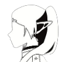
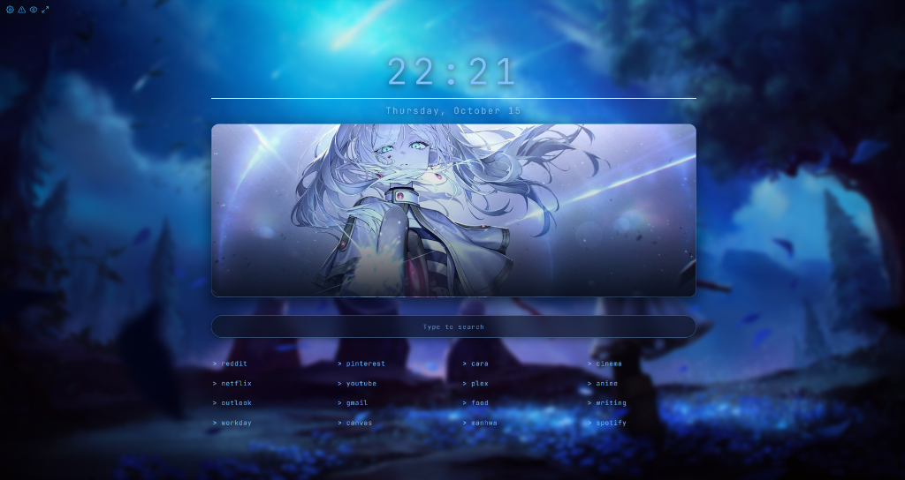
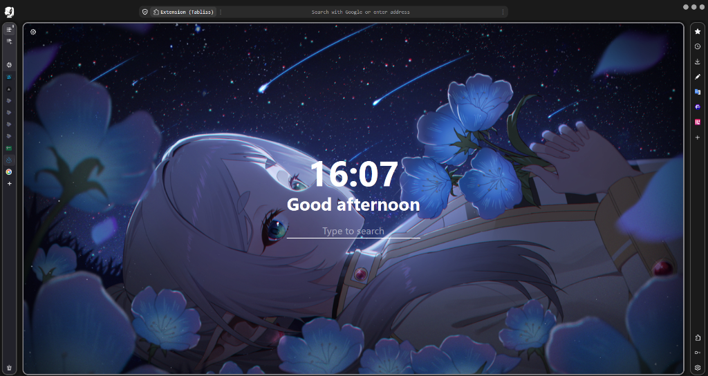

<div align="center">



# フリー・ウェブ (Furi-Web)

*A custom Sousou no Frieren build of Floorp 12 with floating browser chrome, vertical tabs, and a matching new tab page.*

<br/>



</div>

---

## Overview

**Furi-Web (フリー・ウェブ)** is a customized Floorp 12 configuration inspired by *Sousou no Frieren (葬送のフリーレン)* and [Shina-Fox](https://github.com/Shina-SG/Shina-Fox). It combines a minimal floating viewport layout, auto-expanding Sidebery vertical tabs, custom window and taskbar branding (`フリー・ウェブ`), and a clean Blue Moon-weed new tab extension.

## Showcase

<div align="center">
  
</div>

### Included Components

- **Browser Chrome (`chrome/`)**: Floating rounded viewport, centered URL pill, macOS-style window controls, Floorp Panel Sidebar styling, and both dark and light themes (`userChrome.css` and `variants/frieren-blue-moon-weed.css`).
- **Sidebery Theme (`sidebery/sidebery.css`)**: Stylesheet for Sidebery v5 vertical tabs with hover expansion and matching color palettes.
- **Startpage Extension (`releases/frieren_startpage.xpi` & `extension/`)**: Lightweight new tab extension featuring the Blue Moon-weed banner, digital clock, live weather, search bar, and terminal-style quicklinks (plus optional Tabliss presets in `tabliss/`).
- **Window & Taskbar Branding (`autoconfig/`)**: Optional Floorp AutoConfig script (`floorp.cfg`) and custom icons (`dark.ico`) that rebrand the window title and taskbar icon to `フリー・ウェブ`.

---

## Installation

### Automatic Setup (Windows)

1. Close Floorp.
2. Clone this repository:
   ```powershell
   git clone https://github.com/Exryz/Furi-Web.git
   cd Furi-Web
   ```
3. Run **`Install_FuriWeb.bat`** (backs up your existing `userChrome.css` and applies the theme, preferences, and branding automatically).
4. To revert back to default Floorp at any time, run **`Uninstall-FuriWeb.ps1`**.

### Add-on Setup

1. **Startpage Extension**: Open `about:addons` in Floorp, click the gear icon in the top-right corner, select **Install Add-on From File...**, and choose [`releases/frieren_startpage.xpi`](releases/frieren_startpage.xpi).
2. **Sidebery Styles**: Install [Sidebery](https://addons.mozilla.org/firefox/addon/sidebery/), open **Sidebery Settings -> Styles editor**, and paste the contents of [`sidebery/sidebery.css`](sidebery/sidebery.css).

---

## License & Credits

Licensed under the [Mozilla Public License 2.0](LICENSE).

- Base browser: [Ablaze Floorp](https://floorp.app)
- Original layout inspiration: [Shina-Fox](https://github.com/Shina-SG/Shina-Fox) & [Shina-Fox Community Edition](https://github.com/SetyVII/Shina-Fox-Comunnity-Edition)
